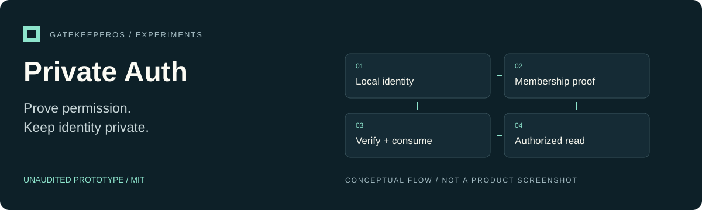
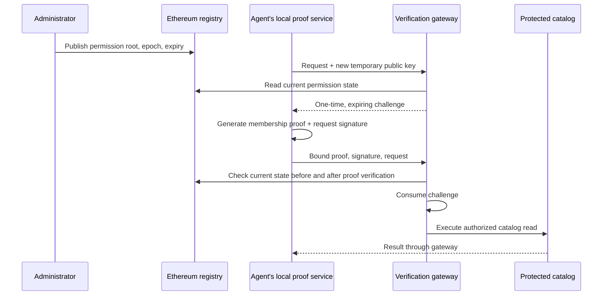

<p align="center"></p>

# Private Auth

**Request-bound agent authorization using local Semaphore proofs and an Ethereum permission registry.**

Unaudited prototype · MIT · [Project overview](docs/OVERVIEW.md) · [Website](https://gatekeeper-os.github.io/private-auth/) · [Landing-page source](docs/site/index.html)

**Local prototype, unaudited.** No production identity enrollment, public-chain deployment, or OpenClaw integration is claimed.

## Quick start

Use Node **22.23.3** and npm 10 or later. No wallet, API key, faucet, Docker, or external RPC is required.

```sh
git clone https://github.com/gatekeeper-os/private-auth.git
cd private-auth
npm ci
npm run artifacts:fetch
npm run dashboard
```

Open the loopback URL printed by the last command. The dashboard creates a new local Ethereum chain, deploys the registry, and enrolls Alice, Bob, and Carol. All state disappears when it stops. It exposes no public listening socket.

Try these interactions:

1. Click **Prove & access catalog**. The agent generates a real proof and the protected HTTP API admits the request.
2. Click **Replay**. The gateway rejects the already consumed challenge.
3. Click **Prepare proof**, then **Revoke** the selected agent, then **Submit prepared**. The registry epoch has changed, so the gateway denies the old proof.
4. Grant access again and generate a fresh proof. Access succeeds.
5. Select **Outsider** and try a request before granting access. It cannot prove membership.

The named agents are test fixtures controlled by the local harness. The production-facing client library performs proof generation on its caller's machine; the verifier receives no identity secret or individual identity commitment. Network metadata and small anonymity sets still limit privacy.

Prefer a terminal?

```sh
npm run demo        # automated, asserted end-to-end demonstration
npm run demo:serve  # interactive grant/revoke/request/replay console
```

The first artifact fetch downloads a depth-8 circuit and proving key from Semaphore's artifact service. Their SHA-256 digests are pinned and checked. Subsequent proofs run without fetching artifacts. A cold install needs network access; this prototype caps groups at 256 leaves.

## What is built

| Component | Responsibility |
| --- | --- |
| `contracts/PermissionRegistry.sol` | Administrator-controlled permission roots, monotonically increasing epochs, expiry, and disablement |
| `src/client.ts` | Local membership proofs, expected-service checks, fresh request keys, and signatures |
| `src/gateway.ts` | Request binding, cryptographic verification, single-use challenges, expiry and revocation checks |
| `src/registry.ts` | Reads the configured chain and registry; rejects unavailable or stale state |
| `src/http.ts` | Small HTTP service exposing challenges and a single catalog-read operation |
| `web/` and `scripts/dashboard.ts` | Loopback demonstration dashboard and disposable administrator/agent fixtures |
| `test/` and `browser/` | Adversarial protocol tests, contract tests, HTTP integration, and browser interactions |

## Authorization flow



The verifier learns the permission group, operation, public proof inputs, and a fresh request key. It does not learn which enrolled commitment produced the proof. Blockchain stores the root, epoch, expiry, administrator address, and update history. Group commitments and membership witnesses are distributed off-chain; no agent secrets belong on-chain.

The registry is an authority chosen by the service operator. Clients cannot supply a different authority. An administrator can admit anyone to its own group, so the service must explicitly trust that administrator.

## Use the library

```ts
import { createRequestKey, present, loadArtifacts } from "./dist/index.js";

const request = { operation: "catalog:read", item: "sensor-a" } as const;
const key = createRequestKey();
const challenge = await fetch(`${gatewayUrl}/v1/challenges`, {
  method: "POST",
  headers: { "content-type": "application/json" },
  body: JSON.stringify({ request, publicKey: key.publicKey })
}).then((response) => {
  if (!response.ok) throw new Error("Challenge unavailable");
  return response.json();
});

const presentation = await present({
  identity,                  // your locally held Semaphore Identity
  group,                     // current membership tree from the administrator
  domain: expectedDomain,    // pinned chainId, registry, audience, permission
  request, key, challenge,
  artifacts: await loadArtifacts()
});
const result = await fetch(`${gatewayUrl}/v1/execute`, {
  method: "POST",
  headers: { "content-type": "application/json" },
  body: JSON.stringify(presentation)
});
if (!result.ok) throw new Error("Authorization denied or unavailable");
```

Run `npm run build` first. Identity enrollment, secure key storage, and distribution of the current group are integration responsibilities; the demo supplies fixture implementations. No npm package is published.

## Verify

```sh
npm run check
npm run demo
npm audit
npx playwright install chromium
npm run test:browser
```

If Chromium is already installed, use `CHROMIUM_PATH=/absolute/path/to/chromium npm run test:browser`. Linux browser dependencies must be installed for Playwright's downloaded browser. The protocol suite compiles Solidity using the pinned local compiler and executes against an isolated Hardhat EVM. No compiler download occurs at runtime.

## Boundaries and next steps

This first version supports one read-only permission and a single gateway process. Challenges are held in memory and disappear on restart. It does not implement pooled spending limits, delegation, public-network anonymity, hardware attestation, exactly-once external writes, or a production operator account system.

Before production use, complete independent cryptographic/security review, durable distributed challenge consumption, authenticated operator enrollment, secure secret storage, rate limiting, RPC/finality policy, and external-chain qualification. The [architecture](docs/architecture.md) explains why those boundaries matter.

Private Auth is separate from the existing [GatekeeperOS runtime](https://github.com/gatekeeper-os/gatekeeper-os). Any future adapter must go through GatekeeperOS's existing grant-resolution and approval boundaries. A proof must never bypass local policy.

## Contributing and license

Read [CONTRIBUTING.md](CONTRIBUTING.md), [AGENTS.md](AGENTS.md), and [SECURITY.md](SECURITY.md). Original code is MIT licensed. See [NOTICE](NOTICE) for upstream components and provenance. GatekeeperOS is independent of the OpenClaw Foundation and the Semaphore project.
